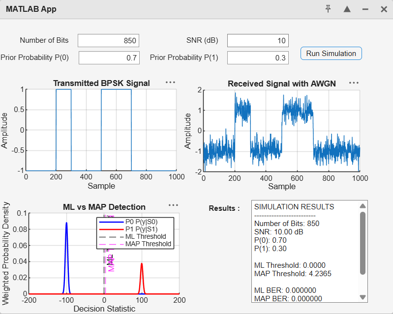

# Digital Communication Receiver

<p align="center">
  
  
  
</p>

A modular MATLAB simulation of a **BPSK digital communication receiver**, featuring Maximum Likelihood (ML) and Maximum A Posteriori (MAP) detection with an interactive MATLAB App Designer GUI.

---

## GUI



---

## Features

- **BPSK Transmitter** — Random binary data generation with pulse-shaped modulation
- **AWGN Channel** — Configurable SNR-based additive white Gaussian noise
- **Matched Filter & Correlator Receivers** — Dual receiver architectures for optimal signal detection
- **ML & MAP Detectors** — Threshold-based detection with configurable prior probabilities
- **BER Analysis** — Monte Carlo simulation over 0–20 dB Eb/N₀ with theoretical comparison
- **Interactive GUI** — MATLAB App Designer interface with real-time parameter control and visualization

---

## Project Structure

```
Digital_Communication_Receiver/
├── main.m                          # Entry point — runs the full simulation
├── transmitter/
│   └── transmitter.m               # Binary data generation & BPSK modulation
├── channel/
│   └── awgn_channel.m              # AWGN channel model
├── receiver/
│   ├── matched_filter.m            # Matched filter receiver
│   └── correlator.m                # Correlator receiver
├── detection/
│   ├── ml_detector.m               # Maximum Likelihood detector
│   └── map_detector.m              # Maximum A Posteriori detector
├── analysis/
│   ├── ber_analysis.m              # BER vs Eb/N₀ performance curves
│   └── visualize_detection.m       # ML vs MAP decision region visualizer
├── GUI/
│   └── receiver_app.mlapp          # Interactive MATLAB App Designer GUI
├── GUI_image.png
└── LICENSE
```

---

## Using MATLAB Online

You can run this project directly in your browser with [MATLAB Online](https://matlab.mathworks.com/) — no local installation required.

1. Sign in at [matlab.mathworks.com](https://matlab.mathworks.com/) with your MathWorks account.
2. Upload the project folder via **Home → Upload → Folder**, or clone the repository:
   ```matlab
   !git clone https://github.com/<your-username>/Digital_Communication_Receiver.git
   ```
3. Navigate to the project directory:
   ```matlab
   cd Digital_Communication_Receiver
   ```
4. Run the simulation:
   ```matlab
   main
   ```

> **Note:** The App Designer GUI (`receiver_app.mlapp`) is fully supported in MATLAB Online. Open it from the file browser to launch the interactive interface.

---

## Output

| Module              | Visualization                                      |
| ------------------- | -------------------------------------------------- |
| Transmitter         | Binary data & BPSK modulated waveform              |
| AWGN Channel        | Transmitted signal, noise, and received signal      |
| Matched Filter      | Filter output & sampled decision statistics         |
| Correlator          | Correlation values per symbol                       |
| ML vs MAP           | Likelihood distributions with decision thresholds   |
| BER Analysis        | Simulated & theoretical BER curves (semilogy plot)  |

---

## Contributing

Contributions are welcome! If you'd like to improve this project, please follow these steps:

1. **Fork** the repository
2. **Create** a feature branch (`git checkout -b feature/your-feature`)
3. **Commit** your changes (`git commit -m "Add your feature"`)
4. **Push** to the branch (`git push origin feature/your-feature`)
5. **Open** a Pull Request

If you find a bug or have a suggestion, feel free to [open an issue](../../issues).

---

## License

This project is licensed under the [MIT License](LICENSE).

---

<p align="center">Made with ❤️ by Ashish</p>